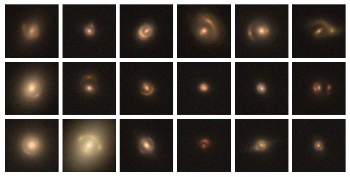
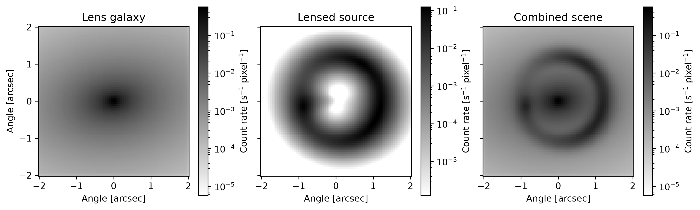
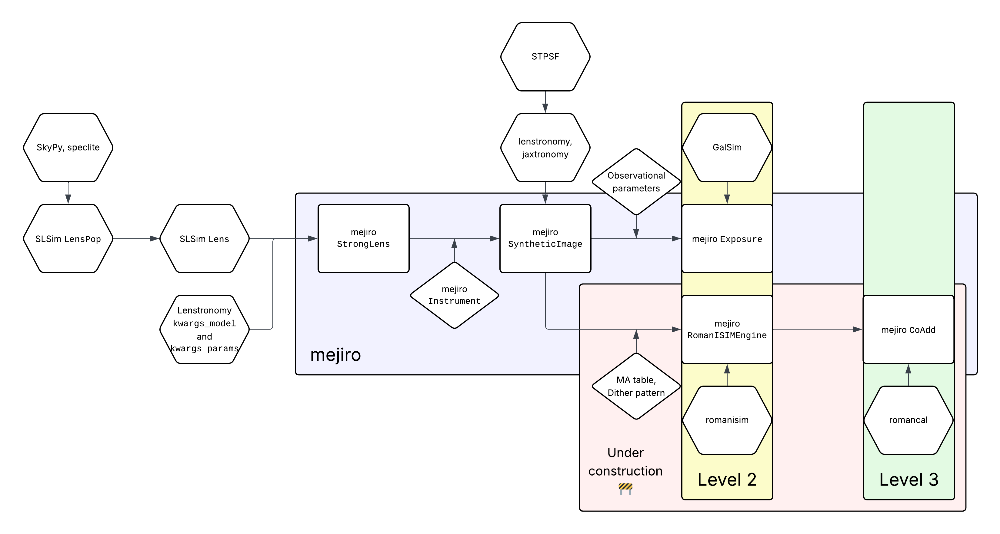

# mejiro

[](https://github.com/AstroMusers/mejiro/actions/workflows/python-app.yml)
[](https://mejiro.readthedocs.io/en/latest/)
[](https://doi.org/10.3847/1538-4357/adc24f)
[](https://arxiv.org/abs/2506.03390)

What would a galaxy-galaxy strong lens look like through a space telescope, and which details of its arcs would survive the instrument? We use `mejiro`[^1] to simulate those images and study their sensitivity to dark matter substructure. We support two lens forward-modeling backends, Lenstronomy and Chalcedon, with GalSim and romanisim providing detector-level integrations. SLSim survey generation and pyHalo realization generation are optional workflows.



> [!NOTE]  
> We use `mejiro` to generate large datasets of simulated Roman images for the [**Roman Strong Lens Data Challenge**](https://roman-data-challenge.readthedocs.io/en/latest/).

# Installation

Install `mejiro` by following [these instructions in the documentation](https://mejiro.readthedocs.io/en/latest/getting_started/installation.html).

# Usage

Set `MEJIRO_PATH` to the checkout directory when using Mejiro from another location. If it is unset, the package uses its checkout root. Local inputs and generated figures belong in the ignored `data/` and `visuals/` directories.

## Plot backgrounds

The image, grid, strip, and corner plotting functions in `mejiro.plots`
accept `typeplotback='dark'` for dark backgrounds with white axes. Their
default is white with black axes, or the theme selected by an enclosing TDpy
`plot_style()` block. Existing image stretches and population values are
preserved. The native strong-lens example also accepts `--typeplotback dark`.

## Strong-lens backend selection

New lens constructors default to Chalcedon. Select `backend="lenstronomy"` explicitly for comparisons. `StrongLens.lens_model`, light models, cached cosmological conversions, image-position solving, and `SyntheticImage` rendering follow the selected backend. The established model/parameter dictionary layout is retained.

```python
from mejiro.galaxy_galaxy import SampleGG
from mejiro.instruments.roman import Roman
from mejiro.synthetic_image import SyntheticImage

native_lens = SampleGG()
comparison_lens = SampleGG(backend="lenstronomy")
native_image = SyntheticImage(native_lens, Roman(), "F129")
comparison_image = SyntheticImage(comparison_lens, Roman(), "F129")
override_image = SyntheticImage(comparison_lens, Roman(), "F129", backend="chalcedon")
```

An image-level override copies the lens when changing engines, so `override_image` does not change `comparison_lens` or its cached cosmology. `image.backend` records the selected engine. Lightweight files include that value. Older files lacking backend metadata load with `backend="unknown"`. Older pickled objects without a backend attribute retain their historical Lenstronomy fallback. Detector-effects engines are selected separately from the lens forward-model backend.

The Chalcedon path does not load Lenstronomy and its native implementation is preserved. Angular coordinates and profile radii use arcseconds, and scene values are count rates per rendered pixel. Its optical convolution is applied on the supersampled scene before detector-pixel binning. Lens and source pieces use the same calculation as the total image.

Install Chalcedon and Mejiro from local checkouts:

```bash
python -m pip install -e /path/to/chalcedon -e /path/to/mejiro
```

Replace each `/path/to/...` value with the location of that repository.

Run the self-contained example from the Mejiro repository:

```bash
python examples/native_strong_lens.py --typefileplot png
```



The example assumes an SIE lens with Einstein radius 1.1 arcsec, external shear, a source at redshift 1.5 behind a lens at redshift 0.5, explicit Sersic profiles, and a Gaussian PSF of FWHM 0.12 arcsec. Its illustrative detector has 0.05-arcsec pixels and a magnitude zeropoint of 25. These are configured model predictions, not observations or a validated mission calibration.

The native backend supports SIS, SIE, EPL, point-mass, external-shear, convergence, NFW, truncated NFW, and elliptical NFW/Hernquist mass profiles. Sersic, Gaussian, Hernquist, interpolated images, and Cartesian shapelets are supported for light. Native multi-plane propagation uses Astropy distances. Elliptical halo labels inherited from CSE use direct projected-density quadrature rather than that expansion. Unsupported mass/light profiles, extinction/special options, and JAX flags raise explicitly rather than falling back to Lenstronomy. Adaptive requests currently use uniform supersampling, preserving integration rather than selective acceleration.

The base install includes both Chalcedon and Lenstronomy. `mejiro[survey]` and `mejiro[substructure]` supply optional external population generators. Telescope extras and `mejiro[filters]` supply independent mission and filter data. Published v1.0 results refer to their original tagged implementation. Selecting another backend does not reproduce those results bit for bit.

> [!IMPORTANT]
> ["The Roman View of Strong Gravitational Lenses" (Wedig et al. 2025)](https://doi.org/10.3847/1538-4357/adc24f) was produced with `mejiro` v1.0.0. To review that version of the code, [click here](https://github.com/AstroMusers/mejiro/tree/v1.0.0).

The pipeline walkthrough in `examples/pipeline_walkthrough.ipynb` follows a lens scene through image formation so you can inspect the calculation at each step.



# Citation

If you use `mejiro`, please cite [Wedig et al. 2025](https://doi.org/10.3847/1538-4357/adc24f) and link to [this GitHub repository](https://github.com/AstroMusers/mejiro). Additional citation information can be found in [`CITATION.cff`](/CITATION.cff).

# Acknowledgment

This research was supported by the National Aeronautics and Space Administration (NASA) under grant number 80NSSC24K0095
issued by the Astrophysics Division of the Science Mission Directorate (SMD) and the McDonnell Center for the Space Sciences at Washington University in St. Louis.

[^1]: "mejiro" ([メジロ](https://ja.wikipedia.org/wiki/%E3%83%A1%E3%82%B8%E3%83%AD) in Japanese) or "warbling
white-eye" (*Zosterops japonicus*) is a small bird native to East Asia with a distinctive white ring around the eye,
much like the shape of a strong lens.
