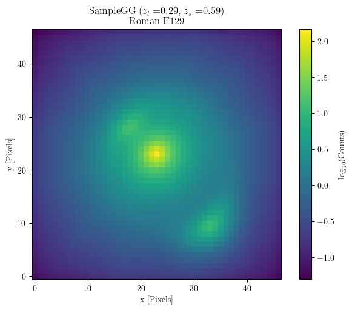

Synthetic Image
===============

A "synthetic image" is the result of ray-shooting and possibly also convolving with a PSF. Importantly, there is no detector noise. The units of the pixels are in counts/sec.

Generating a synthetic image from a strong lens is the first step in simulating the observed image (the "exposure").

.. literalinclude:: ../examples/synthetic_image_roman.py
    :language: python

This produces the following figure:

``synthetic_image``
*******************

.. automodule:: mejiro.synthetic_image
    :members:
    :undoc-members:
    :show-inheritance: